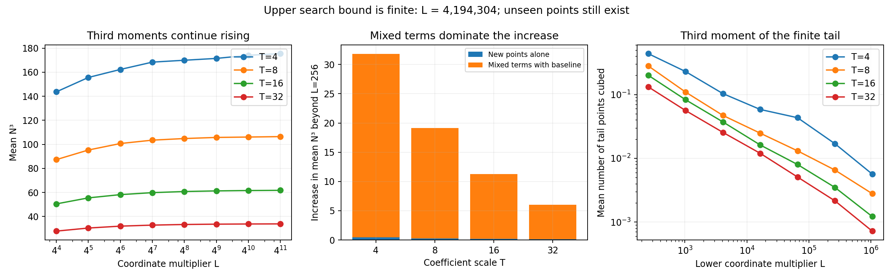

# Continuation: deep coordinate tails and integral tripling

The continuation completed 32 search snapshots over four coefficient scales,
including four independent checks of the previous cutoff. The largest direct
search now reaches x = 134,217,728, a factor of 16,384 beyond its previous
limit. It finds substantial correlation between newly found points and models
already containing several integral points. Exact constructions certify that
there are still points beyond this enlarged search.

The earlier proof is extended to a coordinate range growing with coefficient
height: for every fixed 0 < delta < 1/5, the third moment of the number of
points with |x| <= T^(6/5-delta) tends to zero. This follows from standard
methods; there is no novelty claim or breakthrough on the full moment problem.

## Exact searches

As before, the family is all nonsingular integral models

\[
y^2=x^3+Ax+B,\quad |A|\le T^2,\quad |B|\le T^3.
\]

Both signs of y count, y = 0 counts once, and infinity is excluded. The main
statistics include nonminimal coefficient models, rather than counting each
isomorphism class once. Coefficient boxes at different T are nested.

For T in {4,8,16,32}, the multipliers searched are
L = 256,1024,4096,16384,65536,262144,1048576,4194304. Every coordinate range
is complete up to |x| <= LT. Negative x below -2T cannot occur, so only a
short negative interval needs checking.

| T | Nonsingular models | Largest direct x bound | Signed point incidences | Third moment at L=256 | Third moment at L=4,194,304 |
|---:|---:|---:|---:|---:|---:|
| 4 | 4,252 | 16,777,216 | 8,352 | 143.660395 | 175.442145 |
| 8 | 132,216 | 33,554,432 | 184,896 | 87.288679 | 106.422445 |
| 16 | 4,202,990 | 67,108,864 | 4,179,906 | 50.463796 | 61.745210 |
| 32 | 134,285,276 | 134,217,728 | 94,484,460 | 27.824884 | 33.839978 |

At T = 32, the enlarged scan adds 2,964,814 signed point incidences beyond
x = 8192. The highest point count in the direct census is now 106, on
y^2 = x^3 - 217x + 23425; this is a count within the stated range, not a
certified full integral-point count.

## Main diagnostic: mixed terms dominate the finite increase

Let C count points up to |x| <= 256T and R count points with
256T < x <= 4,194,304T. Then the exact identity is

\[
\mathbb E(C+R)^3-\mathbb EC^3
=3\mathbb E(C^2R)+3\mathbb E(CR^2)+\mathbb ER^3.
\]

At T = 32:

- The total third-moment increase is 6.0150941195.
- The new points alone contribute E(R^3) = 0.1320483714.
- The two mixed terms contribute the remaining 97.8047% of the increase.
- Replacing the mixed moments by products of their observed marginals, as
  independence would require, underestimates the increase by a factor of
  13.6199.

These are exact finite-family count comparisons, with decimals rounded from
integer moment sums. They reject independence as an accurate approximation in
these boxes. They do not prove an asymptotic correlation statement.

The file analysis.json also gives moments for the finite remainder above each
intermediate L. Such a remainder stops at the final direct-search bound and
must not be confused with the entire infinite-coordinate tail.

The mixed-term observation does not invalidate the sufficient tail condition
in the previous proof. Hölder's inequality gives

\[
\mathbb E(C^2R)\le(\mathbb EC^3)^{2/3}(\mathbb ER^3)^{1/3},\quad
\mathbb E(CR^2)\le(\mathbb EC^3)^{1/3}(\mathbb ER^3)^{2/3}.
\]

Thus a suitable bound for the full R^3 moment would also control these mixed
terms. That full tail bound remains unproved. The computational finding shows
why finite-cutoff extrapolation based on independence is unreliable.

## A stronger proved coordinate range

[GROWING_WINDOW_PROOF.md](GROWING_WINDOW_PROOF.md) makes all constants uniform
in the coordinate bound X. For T <= X <= T^2, the derivation gives

\[
\mathbb E N_X^3\ll_\epsilon T^{-1/2}+X^{5/2+\epsilon}/T^3.
\]

It follows that E(N_X^3) tends to zero when X = T^(6/5-delta), for every fixed
0 < delta < 1/5. This extends the previous fixed-multiplier derivation to a
range with X/T tending to infinity. It is still far from treating all
integral points. The argument uses a short-interval divisor sum, the uniform
[Bombieri–Pila theorem](https://people.maths.ox.ac.uk/pila/Ovals.pdf), and the
elementary enumeration used in Lemma 16 of
[Alpöge's average-point paper](https://arxiv.org/abs/1412.1047).

## Certified points beyond the direct search

The data suggested checking triples of small points. For P = (0,b) on
y^2 = x^3 + Ax + b^2, with A,b nonzero and the curve nonsingular, we derived
and verified the exact criterion

\[
3P\text{ is integral}\quad\Longleftrightarrow\quad A^2\mid8b^3.
\]

[TRIPLING.md](TRIPLING.md) gives the proof, explicit coordinates, and a thinness
bound for this marked family. The familiar special cases A = +/-1 and +/-2
already appear in [Zagier's 1986 paper, equation (16)](https://archive.mpim-bonn.mpg.de/id/eprint/737/1/preprint_1986_23.pdf).
They are known constructions, not new examples of a previously unknown
phenomenon.

The criterion produces the following counts of models in our boxes:

| T | Models with integral 3(0,b) | Models whose constructed triple is beyond the direct cutoff |
|---:|---:|---:|
| 4 | 70 | 1 |
| 8 | 280 | 46 |
| 16 | 1,084 | 362 |
| 32 | 3,852 | 1,824 |

For example, the T = 32 box contains

\[
y^2=x^3+x+32761,
\]

with the exact integral point

\[
(x,y)=(2250357013195272,\ 106752273972468818913791).
\]

Its x coordinate is about 16.8 million times the enlarged direct-search bound.
This is a classical family evaluated at b = 181. The script checks the curve
equation and the rational group law using exact arithmetic.

We also tripled all 90,756 nonnegative-y points from the previous T = 8
catalog. After deduplication, this yields 2,897 integral triples, including
52 nonnegative-y point representatives beyond x = 33,554,432. They are saved
as a certified extra catalog, not added silently to the coordinate-census
statistics. The largest example is

\[
y^2=x^3-59x+74,\quad
(x,y)=(7257247018,\ 618241079050562),
\]

which also appears in Zagier's Table 2. Constructed catalogs overlap; the
52-point count should not be added to the marked-family count without
deduplication.

## Verification and implementation

The new scanner independently enumerates (x,y), then calculates the exact
interval of possible A and recovers B. This reduces the work in the far tail
substantially compared with looping over A for every x. Floating-point square
roots provide initial estimates only; 128-bit integer comparisons adjust the
endpoints exactly. The maximum allowed input is bounded explicitly in code.
Integer moment numerators are accumulated incrementally and verified against
Python's unbounded integers.

The verification checked:

- Agreement with the original census's three integer moments at L = 256 for
  all four T values.
- Every one of the 1,549,994 new nonnegative-y point rows, using exact integer
  arithmetic, including uniqueness on each model.
- Independent A,x enumeration of every x from 1025 through 65536 for T = 4.
- Independent complete coefficient slices at another 437 chosen x values,
  including cutoff boundaries, known hits, and reproducible random probes.
- Independent baseline counts on 80 models.
- The full joint count histograms and exact cubic-moment decomposition.
- The marked-family divisibility criterion throughout the coefficient boxes,
  rational group-law checks for every admissible model, and a symbolic
  verification of the constructed curve identity.
- The rational group law for all integral triples found from the T = 8
  small-point catalog; any triple inside the direct-search range agrees with
  its saved point catalog.

All checks passed. Randomness is used only to choose verification probes;
the censuses themselves are exhaustive and deterministic. These checks do
not certify completeness beyond the direct cutoffs, establish novelty, or
prove the full higher-moment theorem.

## Reproduction and files

Run `bash run.sh` from this directory. The prior directory's data are inputs
for the independent baseline checks and T = 8 tripling catalog. Install the
packages in the prior requirements.txt if needed; g++ with C++20 is required.
The largest scanner uses approximately 537 MB for its two count arrays.
The analysis additionally stores encoded state for models with tail points.

- `deep_scan.cpp`: exact (x,y)-first census with incremental moments.
- `analyze_tail.py`: independent checks, moment decomposition, constructions,
  symbolic identity, and plots.
- `data/deep_summary_T*.csv`: 32 cutoff snapshots and integer moment sums.
- `data/joint_hist_T*.csv`: joint distributions of total and new-point counts.
- `data/tail_points_T*.csv[.gz]`: every new nonnegative-y point.
- `data/tail_curves_T*.csv[.gz]`: baseline and tail counts for tail-bearing models.
- `data/deep_top_T*.csv`: the largest observed point counts at the final cutoff.
- `data/constructed_tripling.csv`: marked-family constructions, with cutoff flags.
- `data/tripled_T8_catalog_beyond_search.csv`: 52 deduplicated extra points.
- `analysis.json`, `analysis.log`: analysis and verification outputs.
- `data_sha256.json`: integrity hashes for all saved data artifacts.

The practical next target is a uniform estimate for the full large-coordinate
third moment, or an averaged descent argument that supplies such an estimate.
The new proof and finite data do not supply it. Any such attempt must account
for known integral-multiple families and for dependence between point counts
in different coordinate ranges.
