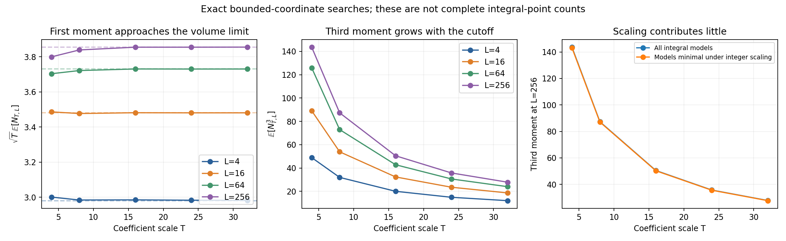

# Elliptic-curve research runs — October 25, 2026

Twenty exact bounded-coordinate searches are complete. The largest box has
134,285,276 nonsingular integral coefficient models. The useful outcomes are a
proved bounded-range moment estimate, an exact counterexample family that
rules out a local shortcut, and quantitative evidence that larger-coordinate
points matter substantially for observed third moments.

**There is no claimed breakthrough, novelty claim, or solution of the full
third-moment problem.** The proof below is a consequence of standard methods;
the unresolved step is control of the points outside a fixed coordinate range.

## Connection to Alpöge's work

The starting point was [Levent Alpöge's publication list](https://alpo.ge/).
The directly relevant paper is Alpöge–Ho,
[The second moment of the number of integral points on elliptic curves is bounded](https://arxiv.org/abs/1807.03761),
especially Theorem 1.6 and Remark 1.9. It bounds full integral-point moments
through log_2(5), using rank-sensitive point bounds and Selmer averages.

Alpöge's earlier
[average-point paper](https://arxiv.org/abs/1412.1047), Lemma 16, already
controls the incidence of small points in a much wider range than the one
used here. The bounded-range arguments in this directory should be read in
that context. His joint
[rational-cubes paper](https://alpo.ge/papers/integers%20expressible%20as%20the%20sum%20of%20two%20rational%20cubes.pdf)
was also reviewed, but the experiments concentrate on the universal family,
rather than claiming a cubic-twist or rational-cubes result.

## What was searched

For T in {4,8,16,24,32} and L in {4,16,64,256}, enumerate all nonsingular
models

\[
y^2=x^3+Ax+B,\qquad |A|\le T^2,\quad |B|\le T^3,
\]

and every integral point with |x| <= LT. Let N_{T,L} count both signs of y
and count y = 0 once. The point at infinity is excluded. This is a coefficient
box ordered by max(|A|^(1/2),|B|^(1/3)); it differs by fixed normalizing
constants from some conventions for naive height in the literature.

The searches are exhaustive **inside their stated coordinate bounds**.
They are not complete integral-point enumerations. Coefficient boxes are
nested, so the five model counts should not be added and described as
distinct curves. Models related by scaling are included in the main averages.
An additional diagnostic restricts to models for which no prime p satisfies
p^4 | A and p^6 | B; this is minimality under short-Weierstrass scaling, not
a general minimal Weierstrass model at 2 and 3.

The moments measured are 1, 2, log_2(5), 2.49, 2.75, and 3. Integer moment
numerators are exact; fractional powers and reported decimal means are
floating-point evaluations of exact count histograms. There is no random
sampling, rank computation, or Selmer-group computation in these runs.

## Results

| T | Nonsingular models | Mean N, L=256 | Mean N^3, L=16 | Mean N^3, L=256 |
|---:|---:|---:|---:|---:|
| 4 | 4,252 | 1.899812 | 89.108655 | 143.660395 |
| 8 | 132,216 | 1.357340 | 53.869743 | 87.288679 |
| 16 | 4,202,990 | 0.963704 | 32.322440 | 50.463796 |
| 24 | 31,879,270 | 0.786865 | 23.480069 | 35.718245 |
| 32 | 134,285,276 | 0.681532 | 18.623094 | 27.824884 |

At T = 32 the final cutoff is |x| <= 8192, and the census contains
91,519,646 signed point incidences. Some models have 88 points within that
bound. Increasing L from 16 to 256 raises the observed third moment by 49.4%.
Thus apparent stability at L = 16 would be misleading.

At T = 32, models not minimal under integer scaling contribute only 0.554%
of the total third-moment numerator at L = 256. Restricting to the minimal
models gives a third moment of 27.698531 rather than 27.824884. This rejects
scaling as the main explanation of the observed third moment in these boxes.
It does not establish a statement about asymptotically rare large points.

For a deliberately partial local diagnostic, 28.87% of the T = 32 third-moment
numerator comes from models with p^2 | Delta for at least one prime in
{5,7,11,13,17,19,23,29,31}, compared with 20.22% of the first-moment numerator.
This shows enrichment for this particular predicate. It is not the full
square-divisor factor from Alpöge–Ho, excludes 2 and 3, and does not identify
the cause of the higher moment.

## A proved bounded-range statement

[PROOF.md](PROOF.md) supplies the details. For every **fixed** L >= 1,
averaging over the integral coefficient models above,

\[
\mathbb E N_{T,L}\sim c_LT^{-1/2},\qquad
\mathbb E N_{T,L}^{\theta}\sim2^{\theta-1}c_LT^{-1/2}
\quad(0<\theta<3),
\]

and

\[
\mathbb E N_{T,L}^{\theta}\to0\quad(0<\theta<4).
\]

In particular, the truncated third moment tends to zero, with the bound
O_{L,epsilon}(T^(-1/2+epsilon)). The higher-moment extension uses the
uniform [Bombieri–Pila theorem](https://people.maths.ox.ac.uk/pila/Ovals.pdf),
Theorem 5, together with a divisor bound on pairs of points with distinct x
coordinates. The corresponding vanishing upper bounds also hold after
restricting to short-scaling-minimal models, a positive-density subfamily;
the displayed leading constants are asserted only for all coefficient models.

The first-moment constant c_256, evaluated by numerical quadrature, is
approximately 3.8555721991. At T = 32, sqrt(T) times the observed first moment
is 3.8553243796, a relative discrepancy of about 0.00643%. The quadrature is a
numerical evaluation, not a certified interval bound. The asymptotic itself
follows from lattice counting, independently of that numerical agreement.

## A rejected shortcut

[LOCAL_OBSTRUCTION.md](LOCAL_OBSTRUCTION.md) proves that at every odd prime p,
the curve

\[
y^2=x^3+(8-p^4)x+p^2
\]

has integral points P = (0,p) and Q = (p^2,3p), but both P+Q and P-Q have
x-coordinate denominator exactly p^2, even though p is a prime of good
reduction. Thus a proposed rule that at least one of the two signs must
remain p-integral cannot be used. This is a standard local group-law
phenomenon, recorded here as a falsified research direction, rather than a
new elliptic-curve theorem.

## The missing step for the full problem

The constants in the bounded-range proof depend on L. Neither the proof nor
the declining finite-box moments permits exchanging the limits T -> infinity
and L -> infinity. A uniform estimate for the third moment of the number of
points with |x| > LT would address the remaining part of this approach;
[PROOF.md](PROOF.md) states the exact sufficient tail estimates.

There is also a separate obstruction to a simple rank-bound approach.
Knowledge of an average of 5^rank, combined only with a point bound having
rank dependence 2^rank, cannot control its third moment. Abstractly, a
variable R equal to m with probability 5^(-m), and zero otherwise, has
E(5^R) < 2 but E(8^R) -> infinity. These are toy distributions, not
distributions asserted to arise from actual elliptic curves. They illustrate
why another estimate, such as a sharper averaged treatment of large points,
is needed.

## Verification and reproducibility

The C++ search enumerates (A,x,y), recovers B, and checks integer square-root
endpoints with exact arithmetic. It uses 64-bit integers in a bounded input
range and 128-bit intermediate square checks. Singular models are excluded
from all reported statistics. Counts are retained in compact arrays, and
exact histograms are saved at each cutoff.

The Python verifier uses an independent direct x-loop and Python's exact
`math.isqrt`. It verified:

- The entire T = 4 census at all four cutoffs, including the scaling filter.
- Every saved histogram and all six moments in each of the 20 runs.
- The five largest point counts in each run: 100 independent curve checks.
- All 90,756 nonnegative-y point rows in the T = 8 census.
- 177,846 exact rational slope/denominator identities.
- 79,662 good-odd-prime pair cases, including 3,500 cases where both signs
  are nonintegral.
- The counterexample family at all 167 odd primes below 1000.

All checks passed. The evidence does not certify the absence of points beyond
the bounds, establish novelty, or prove a full higher-moment theorem.

Run from this directory with `bash run.sh`. The largest census uses about
403 MB for its count arrays, plus normal runtime overhead. Dependencies are
Python 3.12+, g++ with C++20 support, and the packages in requirements.txt.
The run script rebuilds all data and reruns verification.

Files:

- `scan.cpp`: exhaustive bounded-coordinate enumerator.
- `analyze.py`: independent checks, local arithmetic, quadrature, and plots.
- `data/summary_T*.csv`: principal results and exact integer pair counts.
- `data/hist_*.csv`: distributions of N, including zero-point models.
- `data/top_*.csv`: 100 models with the most points at each cutoff.
- `data/local_*.csv`: explicitly partial prime-square diagnostic.
- `data/points_T8.csv`: every nonnegative-y point for the T = 8 final census.
- `analysis.json`, `analysis.log`: analysis and verification outputs.
- `data_sha256.json`: integrity hashes of the saved CSV artifacts.
- `environment.json`: non-secret runtime and package-version metadata.
